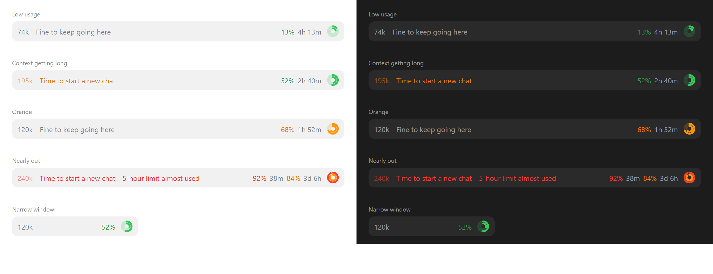
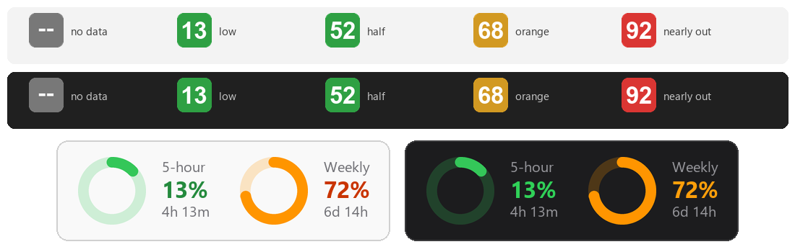

# Claude usage rings

**Your Claude 5-hour and weekly usage, always visible above the prompt box in the Claude desktop app (Claude Code).** No more clicking the ring at the bottom right just to read a percentage. On Windows, a tray icon comes along automatically.

<p align="center">
  
</p>

- **5-hour and weekly limits**: percent used and time until reset, drawn as two concentric rings (outer = 5-hour, inner = weekly)
- **Context length**: size of the current conversation, with a nudge to start a new chat
- **Windows tray icon**: set up automatically, see [below](#windows-tray-icon)

It is a Claude Code plugin (a "mod" that draws UI above the prompt). Needs Claude Code 2.1.287+ and a Pro or Max plan, which report rate-limit data.

## Install

The easy way: send this link to your agent and say "install this".

```
https://github.com/FxrcRed/claude-usage-rings
```

### For agents

If you are an agent and your user asked you to install this, run this in a shell:

```
claude plugin install usage-rings --marketplace FxrcRed/claude-usage-rings
```

It adds the marketplace on its own. Then tell your user: "usage-rings is installed. Start a new session to see it above your prompt." Do not edit their settings file by hand.

### By hand

In a terminal session of Claude Code:

```
/plugin install usage-rings --marketplace FxrcRed/claude-usage-rings
```

From a shell:

```
claude plugin install usage-rings --marketplace FxrcRed/claude-usage-rings
```

In the desktop app, where `/plugin` does not run: click **+** next to the prompt box, then **Plugins**, **Add marketplace** with `FxrcRed/claude-usage-rings`, then **Add plugin**.

Answer `y` to add the marketplace and pick user scope (every session). Before a session's first reply the band shows the last known numbers; after that it is live.

Upgrading from `usage-band` (the old name): `claude plugin uninstall usage-band`, then install as above.

## What it shows

Left: context size in `k` tokens and a hint. Right: percent and time left for the 5-hour window, the weekly percent once it reaches 80%, and the rings.

<p align="center">
  
</p>

| What | Green | Orange | Red |
| --- | --- | --- | --- |
| 5-hour / weekly usage | below 60% | 60–85% | 85% and up |
| Context length | below 180k ("Fine to keep going here") | 180k and up ("Time to start a new chat") | 230k and up |

- Context figures include roughly 80k tokens of fixed overhead (system prompt, tools, skills).
- A "5-hour limit almost used" note appears at 90%.
- In a narrow window (under 50 columns) only the percentages and rings stay.
- Without drawing support (terminal) the rings give way to text.

## Windows tray icon

On Windows the plugin also shows the 5-hour percentage in the system tray (green / orange / red). Click it for a card with both rings, reset times and the last update.

<p align="center">
  
</p>

Nothing to run. At session start the plugin runs `usage-rings/tray/ensure-tray.ps1`, which installs `pillow` and `pystray` with pip if missing (needs Python on `PATH`), adds `ClaudeTray.lnk` to your Startup folder, and starts the icon. While a session is open it restarts the icon within a minute if something closes it. Without Python, the script does nothing and the band works on its own. Windows 11 hides new icons under `^`: drag it onto the taskbar once.

To remove: uninstall the plugin first (otherwise the icon returns), quit the icon from its right-click menu, and delete `ClaudeTray.lnk` from `shell:startup`.

The band and tray share `~/.claude/tray-state.json`. In a terminal-only setup, the CLI can feed the tray by pointing `statusLine` in `~/.claude/settings.json` at `usage-rings/tray/statusline.py`.

## Remove it

```
claude plugin uninstall usage-rings
```

On Windows, also remove the tray icon as described [above](#windows-tray-icon).

## Develop it

Load the folder without installing it:

```
claude --plugin-dir ./usage-rings
```

Run the tests:

```
claude plugin test ./usage-rings
```
