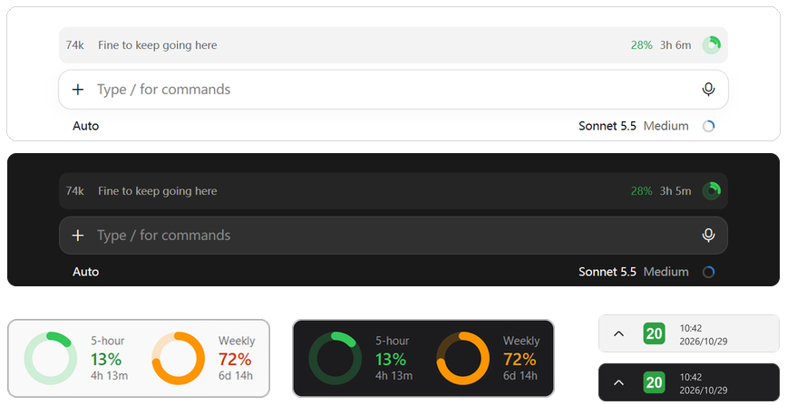

# Claude usage rings

**Your Claude 5-hour and weekly usage, always visible above the prompt box in the Claude desktop app (Claude Code).** No more clicking the ring at the bottom right just to read a percentage. On Windows, a tray icon comes along automatically.

<p align="center">
  
</p>

Anyone on a Claude Pro or Max plan eventually asks "how much of my 5-hour limit is left, and when does it reset?" This plugin answers that all the time, without opening a settings page or typing a command. It also tells you when your conversation has grown long enough that it is time to start a new chat.

- **5-hour limit**: percent used and time until it resets
- **Weekly limit**: percent used and time until it resets
- **Context length**: current conversation size in tokens, with a nudge to start a new chat
- **Windows tray icon**: installed automatically, see [below](#windows-tray-icon-automatic)

It is a Claude Code plugin (a "mod" that draws UI above the prompt), installed in one line from this repository.

## Install

You need Claude Code 2.1.287 or later and a Claude plan that reports rate-limit data (Pro or Max).

In a terminal session of Claude Code:

```
/plugin install usage-band --marketplace FxrcRed/claude-usage-rings
```

From a shell:

```
claude plugin install usage-band --marketplace FxrcRed/claude-usage-rings
```

In the desktop app, where `/plugin` does not run: click **+** next to the prompt box, then **Plugins**, **Add marketplace** with `FxrcRed/claude-usage-rings`, then **Add plugin**.

Answer `y` to add the marketplace and pick a scope (user scope = every session). The band shows up above the prompt in every session. Until a session's first reply it shows the last known numbers (kept in `~/.claude/tray-state.json`); after that it is live.

## What the band shows

Left side: context size in `k` tokens and a short hint. Right side: percent and time left for the 5-hour window, the weekly percent once it reaches 80%, and two concentric rings (outer ring = 5-hour, inner ring = weekly), drawn like Apple's activity rings.

| What | Green | Orange | Red |
| --- | --- | --- | --- |
| 5-hour / weekly usage | below 60% | 60–85% | 85% and up |
| Context length | below 180k ("Fine to keep going here") | 180k and up ("Time to start a new chat") | 230k and up |

The context figures include roughly 80k tokens of fixed overhead (system prompt, tools, skills). A "5-hour limit almost used" note appears at 90% and up.

## Windows tray icon (automatic)

On Windows the mod also sets up a tray icon that shows the 5-hour percentage on a green / orange / red icon. Click it to open a small card with the 5-hour and weekly rings, reset times and when the data was last updated (Esc or a click elsewhere closes it).

Nothing to run: when a session starts, the mod runs `usage-band/tray/ensure-tray.ps1`, which
- installs `pillow` and `pystray` with pip if they are missing (needs Python on `PATH`),
- adds `ClaudeTray.lnk` to your Startup folder so the icon returns after a reboot,
- starts the icon (only one runs at a time).

While a session is open, the mod checks every minute and starts the icon again if something has closed it, for example another program that stops every `pythonw` process.

If Python is not installed, the script quietly does nothing and the band works on its own. Windows 11 keeps new icons in the `^` overflow: drag it onto the taskbar once to keep it visible.

To remove it: disable or uninstall the plugin first (otherwise the icon comes back within a minute), then quit the icon from its right-click menu and delete `ClaudeTray.lnk` from the Startup folder (`shell:startup`).

The band and the tray share `~/.claude/tray-state.json`, which the mod updates after every reply. A fresh or resumed session shows the last known values until its first reply. Without the mod, the terminal CLI can feed the tray through `usage-band/tray/statusline.py` as the `statusLine` command in `~/.claude/settings.json`:

```json
{ "statusLine": { "type": "command", "command": "python /path/to/usage-band/tray/statusline.py" } }
```
